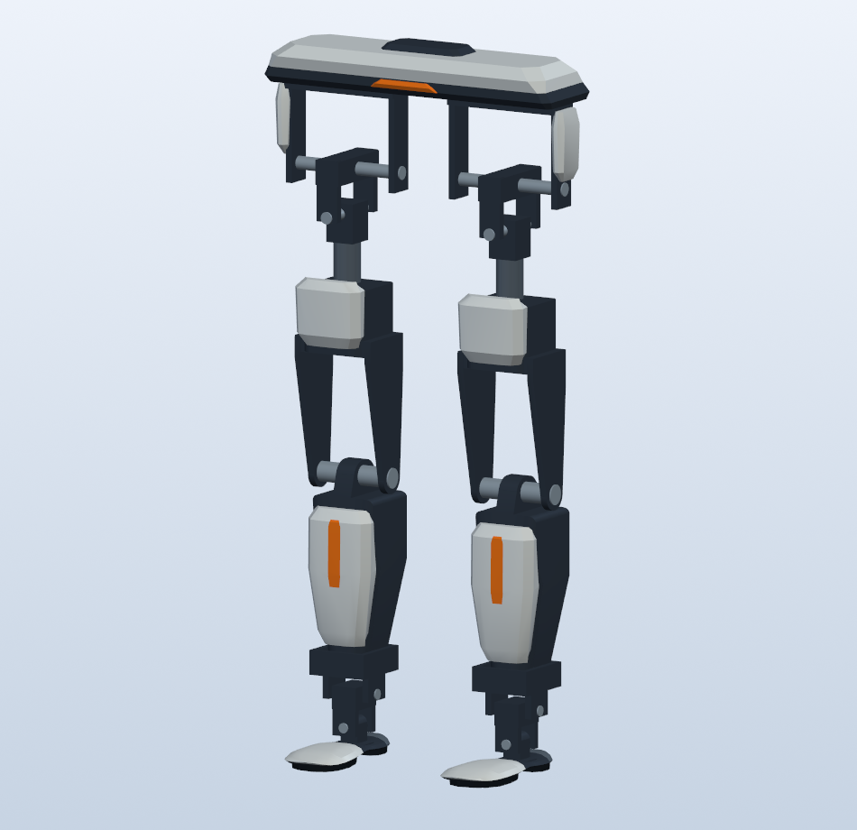
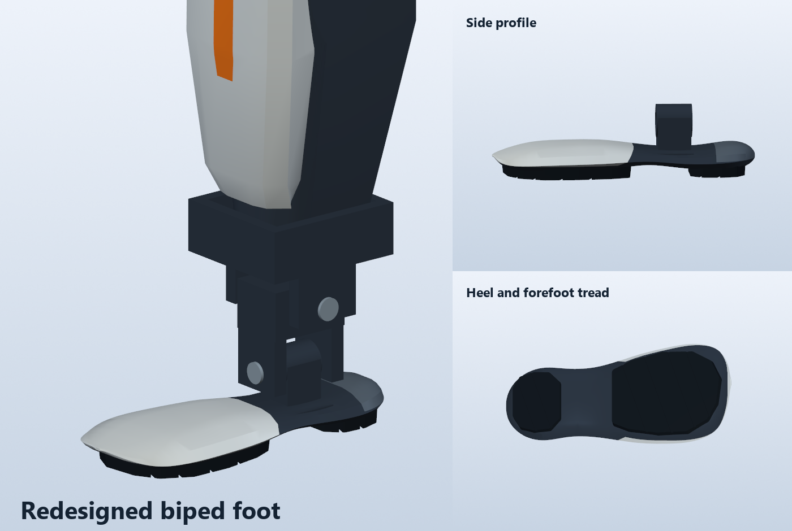

# Humanoid Robot

A simulated humanoid lower body designed in Autodesk Inventor and modeled in MuJoCo. The project grew from a single knee torque experiment into a biped with a shared pelvis, two articulated legs, and separate heel and forefoot contact pads.

## Run the simulation

Install Python, then run these commands from the repository root:

~~~console
python -m pip install -r requirements.txt
python -m mujoco.viewer --mjcf=simulation/biped.xml
~~~

The pelvis support is enabled on startup so you can inspect the mechanism in the viewer. Pause and use the **Joint** sliders to pose the legs, or run and use the **Control** sliders to apply torque. The model includes three inspection poses: neutral, left foot lifted, and ankles tilted.

To run the five-second standing experiment without opening a window:

~~~console
python simulation/stand_test.py
~~~

The test releases the pelvis support, runs 12 joint PD loops, and reports pelvis height and floor loads under the four tread pads.

## Geometry and controls

- Six actuated joints per leg: hip pitch, roll and yaw, knee bend, and ankle pitch and roll.
- A floating pelvis with an optional support constraint for isolated motion tests.
- Rounded feet with a raised midfoot and separate heel and forefoot treads.
- Meshes for visual geometry and contact enabled between the four treads and the floor. Link inertia comes from the CAD geometry and assumed material densities.

## CAD

Open [the Inventor assembly](mechanical/biped.iam) with its [part files](mechanical/cad/) in the supplied folder structure. The assembly is saved in the neutral inspection pose with the occurrences grounded. The [STEP assembly](mechanical/biped.step) can be opened in other CAD programs.

[Single-leg development preview](images/single-leg-development.png) shows the earlier joint range experiments before the pelvis and feet were added.

## Current scope

This is a simulation and mechanism prototype. The standing experiment checks one pose on flat ground. The project does not yet include a walking controller, physical hardware validation, or a model of leg-to-leg contact.
